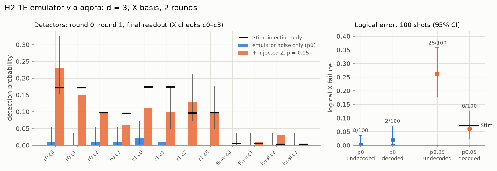
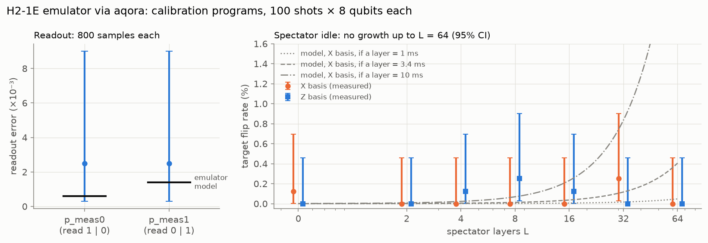
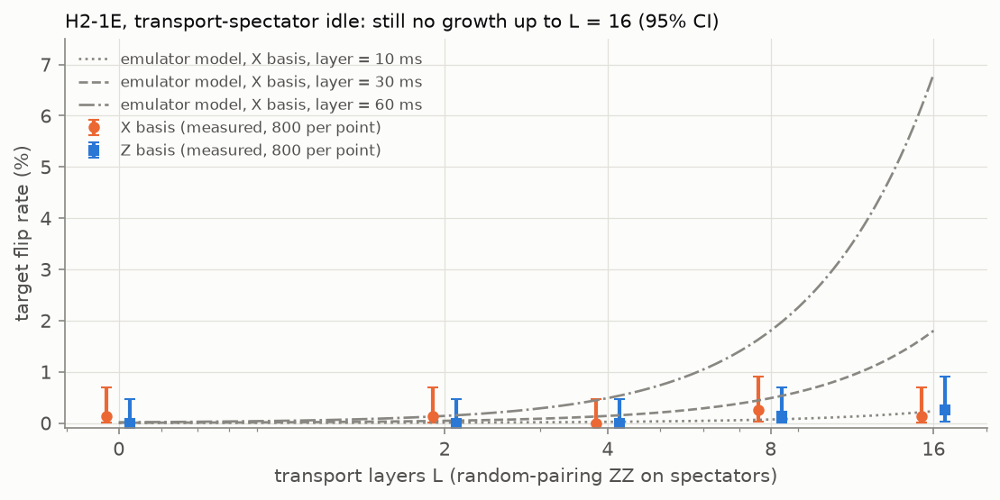
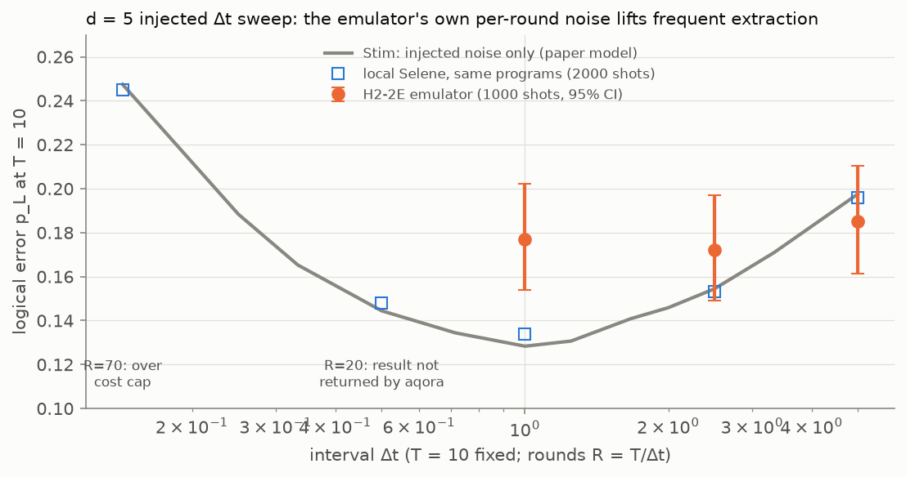
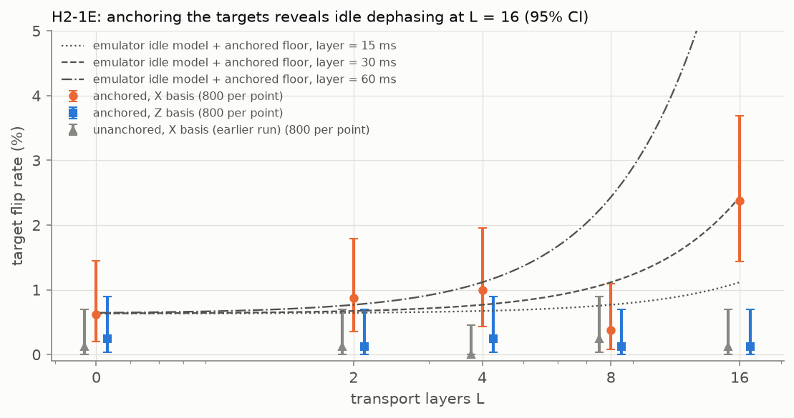

# H2-1E emulator runs (2026-10-14)

Submitted through aqora as organisation `q_sq` (`hardware.cli aqora-submit --confirm`), 100 shots
each, H2-1E's full noise model (aqora cannot set emulator options). d = 3 rotated surface code,
X basis, 2 rounds, one reused ancilla. Raw job records: `store/hardware/*_H2-1E/` (local).
aqora reports `duration: 2` for both jobs: wall-clock of the emulation, not a physical round time.

| program | injected Z per data qubit per round | detector rate | shots with any detection | logical X flips, undecoded | logical failures, decoded | Stim, injection only (200k shots) |
| --- | --- | --- | --- | --- | --- | --- |
| d3_X_r2_p0 | 0 | 0.005 | 3/100 | 0/100 | 2/100 | — |
| d3_X_r2_p0.05 | 0.05 | 0.085 | 65/100 | 26/100 | 6/100 | p_L 0.072, detector rate 0.091 |

Decoding: PyMatching on the paper's phenomenological graph (p_data = injected p, or 2e-3 with no
injection; p_read = 1e-3). With injection, the emulator agrees with Stim within the statistics
(6/100 against 7.2%; 95% interval for 6/100 is 2–13%), so in-program noise injection works end to
end on the emulator. Without injection, decoding turns 0 raw flips into 2 failures: the emulator's
own errors (readout, hook, leakage) are not on the phenomenological graph, so the decoder needs the
emulator's error model, not this graph.

## Calibration programs (readout, spectator idle L = 0-64), 100 shots each

All 15 jobs COMPLETED on H2-1E (`q_sq`). Fit: `h2_1e_calibration_runs.fit.json` (`hardware.cli calib-fit`).

| test | result | H2-1E model value |
| --- | --- | --- |
| readout p_meas0 / p_meas1 | 2/800 = 2.5(18)e-3 each | 0.6e-3 / 1.39e-3 (consistent) |
| X-basis idle, L = 0..64 | flip rate 0-0.25% at every L, no growth (0/800 at L = 64: < 0.37%, 95%) | — |
| Z-basis idle, L = 0..64 | 0-0.25%, flat | Z-only idle: flat |

Reading: up to 64 spectator layers produce no detectable dephasing. With the emulator's own rates
(f = 86 mHz, gamma = 2.8e-3 /s) a 1% flip needs about 0.4 s of idling, so 64 layers of
measure-and-reset are far shorter than that, or the layers are not executed as idle time. Neither
can be told apart at this depth; the grid has to reach ~10^3-10^4 layers (or a known layer duration).

Grey lines: the emulator idle model for an assumed layer duration (1, 3.4, 10 ms). 0/800 at L = 64 rules out
layers of about 3.4 ms or longer (if the layers are executed as idle time).

## Transport-spectator idle (random-pairing zz_max layers), 100 shots each

All 10 jobs COMPLETED on H2-1E (`q_sq`). Fit: `h2_1e_transport_idle.fit.json`.
X basis: 1, 1, 0, 2, 1 flips / 800 at L = 0, 2, 4, 8, 16; Z basis: 0, 0, 0, 1, 2 / 800. No growth.
The emulator's own idle model predicts about 6-7% at L = 16 if a layer lasts ~60 ms (the published
depth-one time); 1/800 bounds the flip rate below 0.7% (95%), i.e. under ~0.3 s of effective
idling in 16 layers, if the emulator's dephasing acts at its listed rates on this route.

## d = 5 injected Δt sweep on H2-2E (2026-10-14/15), 1000 shots per point

Programs: d = 5, X basis, the paper's p_data(Δt) injected in-program (p = 0.015, λ = 1, T = 10);
record flips p_read = 0.015 added offline (`records.add_record_flips`). Syntax-checked on H2-1SC/H2-2SC.

| R (Δt) | H2-2E p_L | Stim (injected only) | note |
| --- | --- | --- | --- |
| 70 (0.14) | — | 0.247 | rejected: "Job cost exceeds allowed cost (1002)" |
| 20 (0.5) | — | 0.142 | COMPLETED (6.7 h) but aqora never pulled the result (resultUploadAttempts 0) |
| 10 (1) | 177/1000 = 0.177 | 0.134 | +4.0σ |
| 4 (2.5) | 172/1000 = 0.172 | 0.156 | +1.4σ |
| 2 (5) | 185/1000 = 0.185 | 0.199 | −1.1σ |

The emulator's own per-round noise lifts p_L most where there are most rounds: the U flattens and
its minimum moves to longer Δt. Decoding uses the paper-model graph (emulator errors not on it).

### Circuit-level decoder and prediction (no new runs)

`hardware/program_model.py` rebuilds the hardware program in Stim gate for gate (one reused
ancilla, serial checks, injected p_data(Δt)) with H2-2E's p1 = 7.3e-5, p2 = 1.29e-3 and, as an
assumption, H2-1E's p_meas = 1e-3, p_init = 4e-5; no idle dephasing or leakage. Its DEM decodes the
returned shots; sampling it predicts p_L. Checks: without gate noise it reproduces the paper model
(0.144/0.132/0.153/0.200 vs 0.142/0.134/0.156/0.199) and decodes local Selene identically.

| Δt | H2-2E, paper graph | H2-2E, circuit decoder | model with H2-2E gates | difference |
| --- | --- | --- | --- | --- |
| 1 | 0.177 | 0.173 | 0.159 | +1.2σ |
| 2.5 | 0.172 | 0.172 | 0.173 | 0.0σ |
| 5 | 0.185 | 0.191 | 0.208 | −1.4σ |

The emulator matches the circuit model within ~1σ once its gate noise is included; the decoder
change is small (≤ 0.006). So the earlier +4σ at Δt = 1 was the emulator's per-round gate cost, not
decoder mismatch. The model with H2-2E gates has a flatter U (minimum ≈ 0.158 near Δt ≈ 1–1.25).
Data: `h2_2e_dt_sweep_d5_circuit_decoder.json`, `h2_2e_dt_sweep_d5_model_curves.json`.

## Anchored transport-spectator idle (targets tied to the start of the wait), H2-1E, 100 shots each

X basis: 5, 7, 8, 3, 19 flips / 800 at L = 0, 2, 4, 8, 16; Z basis: 2, 1, 2, 1, 1 / 800 (flat).
Against the unanchored run (1/800 at L = 16), anchoring brings out a rise at L = 16 (~3.5σ over the
L = 0 floor of 0.6%, raised by the two target-anchor ZZ gates). One point above the floor: a timescale
of ~30 ms per layer is indicative only (fit in `h2_1e_anchored_idle.fit.json` is unconstrained,
χ²/dof 13). Next: L = 32-64 and more shots.

